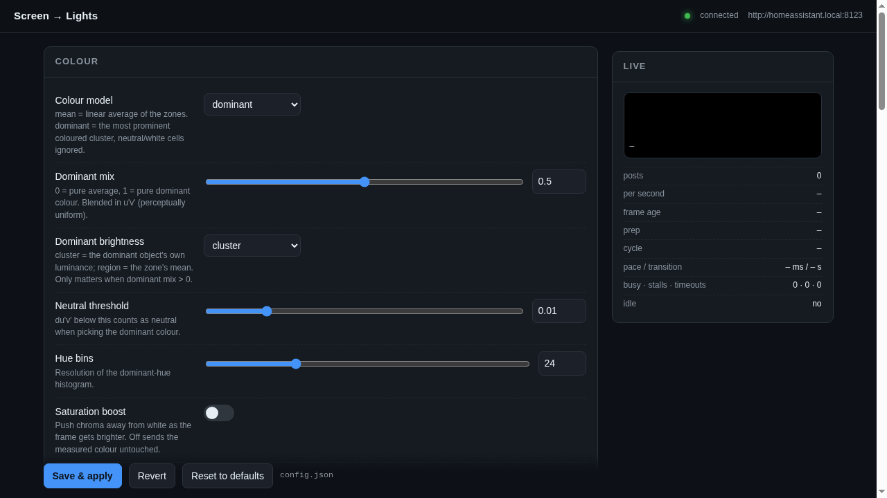

# HASS Ambilights

**Version 2.5.0** · [changelog](CHANGELOG.md) · [semantic versioning](https://semver.org)

Mirror what's on your screen onto Home Assistant lights — Ambilight style — with a
web UI for every knob, and a colour pipeline that actually matches the panel.



- **3×3 zone mapping** — give each light any subset of nine screen regions (`1,4,7`
  = left column, `5` = centre only, `all` = the whole screen).
- **Colour that matches** — chromaticity is computed in linear light and sent as
  `xy_color`, so the lamp reproduces it to within du'v' 0.0001 of what you measured.
- **Average or dominant** — mirror the whole region, the most prominent *coloured*
  cluster, or a blend of the two.
- **Right-size brightness** — true luminance, perceptual CIELAB L*, or the brightest
  channel; with a gamma curve and no hard clamps.
- **Cheap** — 6.6 ms/frame at 4K (~8 % of one core), and it idles down to 4 fps when
  the screen is static.
- **Fast** — new frames go out immediately, stale ones are dropped, and each cycle's
  lights are dispatched concurrently.
- **Radio-aware sending** — pacing, BUSY backoff, coordinator-stall hold-off, and a
  host-down circuit breaker. **Auto tune** measures your mesh — every light at once, the
  way a frame actually goes out — picks the pacing instead of you guessing it, and sets
  the capture rate to match what the radio accepted.

## Install

### Windows

Download `HassAmbilights.exe` from the [latest release](../../releases/latest) and run it.
It opens a window with the settings page. **Closing the window hides it to the tray** and
mirroring carries on — use the tray icon to reopen it or quit for real. Turn off
*Close to tray* in the Server card if you would rather closing quit the app. It is
unsigned, so Windows SmartScreen shows "unknown publisher" the first time —
*More info → Run anyway*.

- Settings live in `%APPDATA%\HassAmbilights`, logs in `%LOCALAPPDATA%\HassAmbilights\logs`.
- **Start with Windows** (Server card) adds a login entry that launches it in the tray;
  the tray has *Open settings* and *Quit*.
- Only one copy runs at a time — launching again focuses the running one, and a busy port
  picks the next free one.
- Build it yourself with `powershell -ExecutionPolicy Bypass -File packaging\build.ps1`.

### Script

One file, one command. Download `hass_ambilights.py` and run it:

```bash
python hass_ambilights.py
```

The first run creates `.venv` beside the script, installs what it needs (fastapi,
uvicorn, mss, pillow, numpy, requests), and starts. It then opens
<http://127.0.0.1:8000/> so you can paste your Home Assistant URL and a
**long-lived access token** (profile → *Security* → *Long-lived access tokens*) into the
**Home Assistant** card — no environment variables, no config file, nothing else to
install. An environment that already has those packages is used as-is, so a venv you
manage yourself works too.

The settings page is embedded in the script, so a single copied file is a complete
install. Nothing needs a network round trip except the packages on first run.

Subsequent runs start in about a second — the install is skipped once `.venv` is
populated.

Settings saved in the UI go to `config.json` next to the script and are applied live.
That file outranks the environment — quietly, which is worth knowing if you set a value
in both places. The token is kept out of it, in `secrets.json` (0600).

Prefer environment variables? They still work, and `config.json` beats them:

```bash
export HA_URL=http://192.168.1.10:8123
export HA_TOKEN=eyJ...
export LIGHT_MAP="light.left_lamp=1,4,7; light.right_lamp=3,6,9"
python hass_ambilights.py
```

```powershell
# PowerShell
$env:HA_URL="http://192.168.1.10:8123"; $env:HA_TOKEN="..."; python hass_ambilights.py
```

Run it on the machine whose screen you want to mirror — `mss` needs a display, so a
headless NAS can't capture. It logs a clear message and keeps serving the UI if it
can't see one.

Command line: `--window` (native window), `--tray` (tray icon only), `--server` (serve
only, no window or tray — services and CI), `--calibrate`, `--no-browser`, `--version`.

## The settings UI

`GET /` serves the UI that is embedded in `hass_ambilights.py` — no build step, no
separate asset, no dependencies beyond the app itself.

- **Settings**, grouped (Colour · Brightness · Capture · Sending), each with a slider or
  select and a one-line explanation. Fields that need a restart are tagged `restart`.
- **Lights**: a row per light, picked from your Home Assistant's own light entities
  (`GET /api/lights`) rather than typed — friendly name, entity id, and `(no colour)`
  marked on the ones that can't do hue. **↻ From Home Assistant** reloads the list;
  typing by hand is still possible when the instance can't be reached. Each row has its
  own 3×3 zone picker, and zones are serialised back into `LIGHT_MAP`.
- **Edits are live, saving is explicit.** Every change is applied to the running
  process about a third of a second later (`POST /api/config` with `persist: false`),
  so you tune against real light output; nothing reaches `config.json` until
  **Save & apply**. The header badge means "running differs from the file", and it
  survives a page reload — reopen the page with unsaved changes and the badge is
  still there. **Revert** puts the file's values back into the process, **Reset to
  defaults** rewrites `config.json`. The Home Assistant URL and token are the
  exception: they apply on Save, so typing them can't reconnect mid-keystroke.
- **Advanced sections.** Each card keeps its everyday knobs out and collapses the
  rest behind **Advanced** (payload colour space, hue bins, pacing, breaker tuning…),
  remembering whether you had it open. Settings a mode doesn't use are hidden rather
  than disabled: the saturation controls appear only when boost is on, and the
  dominant-mode knobs only in dominant mode.
- **Live panel**: a row per light showing its current colour chip, hex, brightness and
  counters; a nine-cell strip of the zone colours (outlined cells are the ones in use).
  Both are the *payload* colour, not the raw screen average — the same transform that
  builds the service call, dimmed to the brightness being sent, so what you see is what
  the bulb gets;
  and posts/sec, frame age, prep time, cycle time, pace/transition, busy · stalls ·
  timeouts, idle state, and the last calibration result.
- **Calibrate…** runs the twelve-colour accuracy check against the first light from the
  browser, flashes it for ~7 s, restores it, and reports worst du'v' and dE76.

## Lights and zones

The screen is split into nine zones, numbered in reading order:

```
1 2 3
4 5 6
7 8 9
```

Set them in the UI, or in `config.json` / env:

```
LIGHT_MAP="light.left_lamp=1,4,7; light.center_lamp=2,5,8; light.right_lamp=3,6,9"
```

Lights that end up with identical colour and brightness are sent in a single service
call, so the Zigbee radio isn't asked to do the same work twice. Only the rectangle
covered by the zones in use is captured at all.

**Monitor** (Capture card, restart to apply) is a list of what the machine actually
has: `0` combines every monitor onto one canvas, `1` is the primary, `2+` are the rest,
each labelled with its resolution and position. Multi-monitor setups no longer have to
guess which index is the screen they're looking at.

## The colour knobs

| setting | what it does |
|---|---|
| `COLOR_ALGO` | `mean` = linear average of the zones; `dominant` = the most prominent *coloured* cluster, neutral cells ignored (default) |
| `DOMINANT_MIX` | 0–1 slider between those two models, blended in u'v' (default 0.5) |
| `DOMINANT_LUMINANCE` | brightness follows the winning cluster (`cluster`, default) or the whole region (`region`) |
| `CHROMA_FLOOR` | how colourful a cell must be to vote at all — this is what makes white pages and grey UI stop washing the colour out (default du'v' 0.010) |
| `HUE_BINS` | dominant mode's hue resolution: 24 = 15° buckets, and the winner is averaged with its two neighbours. Lower merges two similar hues into one steady colour; higher separates them but can flicker between neighbours (default 24) |
| `SATURATION_BOOST` | off by default: sends the measured chromaticity untouched. On, it pushes chroma away from white as the frame brightens, capped and gamut-clamped |
| `BRIGHTNESS_FROM` | `luminance` (physical), `lstar` (perceptual, default), `value` (brightest channel — hue has no effect) |
| `BRIGHTNESS_GAMMA` | tone curve on the brightness input |
| `SEND_MODE` | `xy` (default, precise) or legacy `rgb` |
| `ZONE_ROWS`, `ZONE_COLS` | how many zones the screen is split into (default 3 × 3). Up to 8 × 8, so a wide desk can be 5 × 3 and a wall of spotlights 4 × 4. Zones are numbered in reading order; shrinking the grid is refused while a light's mapping still uses a zone that no longer exists |

Rule of thumb: a white page holding one vivid photo is a pale wash under `mean` and
the photo's colour under `dominant`. `DOMINANT_MIX` decides how far you travel, and
`DOMINANT_LUMINANCE` decides whether the room follows that object's brightness or
keeps the zone's overall level.

## Credentials and exposure

`HA_URL` and `HA_TOKEN` are ordinary settings: editable in the UI, and the token is the
only value that never comes back over the wire. It is stored in `secrets.json`
(`chmod 600`, gitignored) rather than `config.json`, reported to the browser only as
`<set>`/`<unset>`, and masked out of save responses. Leave the field blank to keep the
saved token, or press **Clear** to remove it.

The UI itself has no authentication, so it listens on **`127.0.0.1:8000` by default** —
this machine only. `BIND_HOST` and `BIND_PORT` (Server card) change that, and saving either
restarts the app so the change actually takes effect — the page follows it to the new port.
Set `BIND_HOST=0.0.0.0` to reach the UI from another device, and only on a
network you trust, since anyone who can reach that port can change settings, read the
light mapping, and trigger a calibration flash. The bundled systemd unit sets
`BIND_HOST=0.0.0.0` explicitly — comment that line out to keep it local. Put it behind
your reverse proxy's auth if it needs to be reachable from outside.

`config.json` outranks the environment, `BIND_*` included — once the file has a value,
the environment variable for that setting is ignored.

## Endpoints

| path | purpose |
|---|---|
| `GET /` | settings UI |
| `GET /api/config` | current settings + metadata + light list |
| `POST /api/config` | validate and apply (`{"settings":{...}}`, or `{"reset":true}`); `"persist": false` applies without writing `config.json`. Values are type- and range-checked: a null, a bool where a number belongs, `inf`, an unknown enum or an out-of-range number is a `400` naming the setting, and nothing is applied |
| `GET /api/lights` | light entities from HA for the picker (30 s cache, `?refresh=1` to bypass) |
| `GET /api/monitors` | monitors mss can capture, for the Monitor picker (0 = all combined) |
| `POST /api/test-connection` | probe HA with the saved or just-typed URL + token |
| `POST /api/calibrate` | run the accuracy check in the background (`409` if one is already running) |
| `GET /health` | `version` plus live stats: posts, frame age, cycle time, pace, busy/stalls/timeouts, per-light counters, calibration state |
| `GET /regions` | the nine zone colours for the current frame |
| `GET /raw_grid` | the 64×36 sample grid |

`python hass_ambilights.py --calibrate` pushes twelve test colours to one light,
measures the chromaticity it reports back (expect du'v' ≈ 0.0001 on a healthy
installation), and restores the previous state.

## Notes from real hardware

These cost the most time, so they're documented up front:

- **Send `xy_color`.** HA converts `rgb_color` with the Philips-Hue wide-gamut matrix
  and clips — measured drift up to du'v' 0.09, where 0.003 is one just-noticeable step.
- **Average in linear light**, not on gamma-encoded bytes: half white + half black is
  188, not 128.
- **Never call `mss`'s `shot.rgb`** — it's a 24 MB strided copy (44 ms/frame at 4K).
  Read the BGRA buffer as a numpy view and let PIL decode `BGRX`.
- **Clear `CAPTUREBLT` before grabbing.** mss always sets it, and at capture rates the
  flag makes the hardware cursor flicker and jump to the top-left corner in step with
  the loop on many Windows drivers ([python-mss #179](https://github.com/BoboTiG/python-mss/issues/179)).
  `disable_captureblt()` zeroes the constant before the first grab; layered overlays
  may then be missing from the mirrored image.
- **The device ack, not HTTP, is the latency.** Transport is ~4 ms; a single Zigbee
  spotlight takes ~121 ms per command while a group takes ~37 ms on a test ZHA mesh.
  Dispatch a cycle
  concurrently, and don't wait on each backoff.
- **A read timeout is not "HA down".** If the coordinator's serial link resets
  (`bellows … ERROR_EXCEEDED_MAXIMUM_ACK_TIMEOUT_COUNT` → `ControllerError:
  ApplicationController is not running`), commands hang while HA is perfectly
  healthy. The script treats that as a radio stall (drop the frame, back off,
  hold two seconds), not as an outage.
- **A `color_temp` change sent with `transition > 0` can be silently dropped** by a ZHA
  group, so restores are sent with `transition: 0` and verified.

## Versioning

`__version__` in `hass_ambilights.py` is the single source: it is printed by
`python hass_ambilights.py --version`, shown in the UI footer, and returned by
`GET /health` and `GET /api/config`, so you can tell which build is actually running.

MAJOR for changes that need you to do something (config or API), MINOR for new
capability, PATCH for fixes. Releases are git tags `vX.Y.Z` with a matching
`CHANGELOG.md` entry — the test suite fails if the changelog has no section for the
current version.

## Development

```bash
python tests/test_hass_ambilights.py      # 17 phases, fake screen + mock HA, no display needed
```

The test suite covers the colour maths (white point, sRGB primaries, linear averaging),
zone splitting, per-light dedupe and rescue, stale-frame dropping, BUSY handling,
concurrent dispatch, the circuit breaker, capture cropping, dominant mode on letterboxed
frames, the settings API (credentials never echoed, secrets kept out of `config.json`,
loopback bind default), and that the embedded page is self-contained.

The UI is a string in `hass_ambilights.py` (`UI_HTML`), not a separate asset — keep it
that way, otherwise a copied file is no longer a working install.

`tools/live_probe.py` sends a synthetic frame through the real sender and prints post
rate, cycle time and per-light counters — useful when tuning against actual hardware.

## Licence

MIT.
